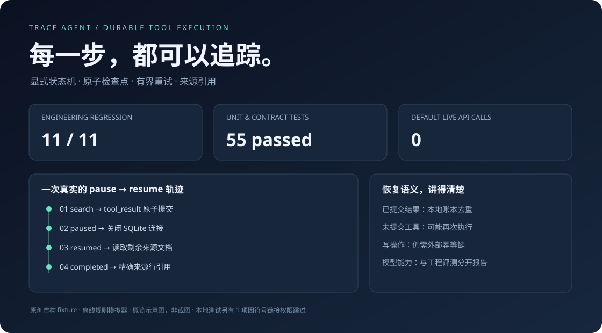
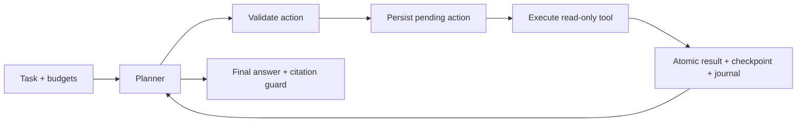

# Trace Agent

具有持久检查点和执行日志的工具调用运行时。支持暂停恢复、受限只读工具、有界重试和独立 HTML 轨迹报告。



运行时只依赖 Python 标准库。默认使用确定性的离线规则策略，不需要 API key；设置 `--provider chat` 可接入支持工具调用的 OpenAI-compatible Chat Completions 服务。两种策略共用状态机、工具授权、执行预算和持久化逻辑。

## 快速开始

Python 3.11+，从仓库目录执行：

```bash
python -m trace_agent demo
python -m trace_agent evaluate
```

打开 `out/demo/index.html` 查看任务、来源引用和逐事件轨迹；打开 `out/evaluation/index.html` 查看故障案例。两个报告均为单文件 HTML，可直接离线打开。

`demo` 执行“搜索后暂停 → 关闭数据库连接 → 重开连接 → 从检查点继续”。也可以手动创建、暂停和恢复任务：

```bash
python -m trace_agent run "缓存 cache 故障根因是什么？" --stop-after 1
# 把输出的 run_id 代入下一条命令
python -m trace_agent resume RUN_ID
python -m trace_agent inspect RUN_ID --out out/inspect
python -m trace_agent run "计算: (128 - 96) / 128 * 100"
```

也可安装后在其他目录运行，内置演示文档随包安装：

```bash
python -m pip install -e ".[dev]"
trace-agent demo --out out/demo
python -m pytest -q
```

## 运行时能力

| 能力 | 具体实现 | 可以检查的证据 |
|---|---|---|
| 显式状态机 | `running / paused / completed / failed / budget_exceeded`，pending action 在执行前持久化 | [runtime.py](trace_agent/runtime.py) |
| durable checkpoint | 工具结果、调用账本、状态和事件在同一个 SQLite 事务中提交 | [store.py](trace_agent/store.py) |
| 恢复与去重 | 已提交结果按 `run_id + call_id` 读取；未提交的只读调用允许重做 | [恢复测试](tests/test_runtime.py) |
| 工具权限 | 固定 allowlist、参数类型与数量限制、Markdown 根目录约束、符号链接解析 | [tools.py](trace_agent/tools.py) |
| 算术计算 | AST 节点白名单与数值边界，不使用 `eval`、shell 或代码解释器 | [工具测试](tests/test_tools.py) |
| 有界执行 | 决策次数、工具总尝试次数、每步重试次数独立限制 | [评测结果](artifacts/evaluation/evaluation.json) |
| 可观测性 | journal 中保留计划、调用、重试、暂停与完成事件；HTML 可展开检查 | [演示报告](artifacts/demo/index.html) |
| 可选真实模型路径 | 串行 tool calling、环境变量凭据、HTTPS、禁止重定向、响应结构验证 | [planners.py](trace_agent/planners.py) |

内置 `search` 使用中英文词项重合排序。离线策略先搜索，再读取前两篇文档，最后按来源行与查询的词项重合摘录证据。检索与规划通过接口独立于运行时，后续可替换为专门的检索器或模型策略。



## 本地实测

2026-11-24，Python 3.14.6，Windows；运行上面的测试与评测命令得到：

| 验证 | 结果 |
|---|---:|
| pytest | **55 passed，1 skipped** |
| 固定工程回归案例 | **11 / 11** |
| 真实模型 API 调用 | **0** |
| 默认 demo 的工具调用 | **3**：search、read、read |
| 默认 demo 的决策次数 | **4**：3 次工具决策 + 1 次结束 |

唯一跳过的测试需要 Windows 创建符号链接权限。这里记录的是本地运行结果。

11 个案例分别覆盖带引用回答、阈值证据、算术、未知问题拒答、连接重开后的恢复、瞬时故障、重试耗尽、工具白名单、路径穿越、决策预算和伪造引用。[完整结果 JSON](artifacts/evaluation/evaluation.json) 与 [演示 trace JSON](artifacts/demo/trace.json) 均来自实际运行。

评测使用 4 篇虚构运维文档，目标是验证执行和恢复语义。在线适配器通过 mock 合约测试，尚未记录真实服务上的任务成功率、提示注入评测或延迟基准。

## 替换为自己的知识库

```bash
python -m trace_agent run "发布前检查什么？" --root ./my-markdown
python -m trace_agent run "cache" --max-steps 8 --max-attempts 10 --max-retries 1
```

输入为 UTF-8 `.md` 文件，单文件最多 256 KiB，最多扫描 500 篇；每次读取最多 120 行和 12000 字符。`read` 的引用采用 `[relative/path.md:L5]`，行号从 1 开始。最终回答中出现的引用必须对应本轮实际读过的行，**这个检查只能验证引用来源，不能自动验证主张是否被该行支持**。

## 可选：连接真实模型

仅在显式选择 `--provider chat` 时才会请求 API。模型名由使用者设置，不在代码里绑定特定型号。

```powershell
$env:TRACE_AGENT_API_KEY = "your-key"
$env:TRACE_AGENT_MODEL = "your-tool-capable-model"
$env:TRACE_AGENT_BASE_URL = "https://api.openai.com/v1"
python -m trace_agent run "缓存故障的根因和修复方式是什么？" --provider chat
```

Bash 可用 `export TRACE_AGENT_API_KEY=...` 等价设置。该路径会把任务和工具读取到的文档内容发往指定服务；API key 不写入状态或报告。支持 HTTPS，以及本地开发所需的 loopback HTTP。默认拒绝 HTTP 重定向，避免认证头被转发。兼容端点需支持 `/chat/completions`、`tools` 和 `parallel_tool_calls=false`。每次请求超时 30 秒；预算控制次数，不控制美元成本。重试费用由服务提供方计费规则决定。

## 运行边界

- 单个 run 同时只由一个 worker 执行；SQLite revision 检查防止陈旧状态提交，但没有分布式租约。
- 工具返回到结果提交之间发生崩溃时，工具可能再次执行。内置工具只读；新增写操作需要下游幂等键。
- 引用检查验证来源行是否已读取，不判断该行是否支持答案中的每个主张。
- 路径约束针对受信任、静态的本地文档目录，不提供操作系统级沙箱或文件变动隔离。
- 次数预算不等价于 token、费用或任务总时长预算。

使用方法、参数、输出和排障见 [CLI 与配置](docs/usage.md)；状态转换、事务边界和扩展点见 [设计与恢复语义](docs/design.md)。

MIT License。仓库中的运维文档和业务数值均为测试 fixture。

## English overview

A dependency-free agent runtime with SQLite checkpoints, an atomic result journal, read-only tools, bounded retries, provenance checks, failure injection and standalone HTML traces. The default planner is a deterministic offline policy. A Chat Completions adapter is available through explicit configuration and is covered by mock contract tests.

