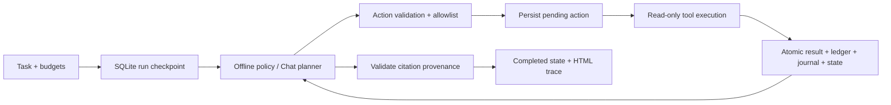
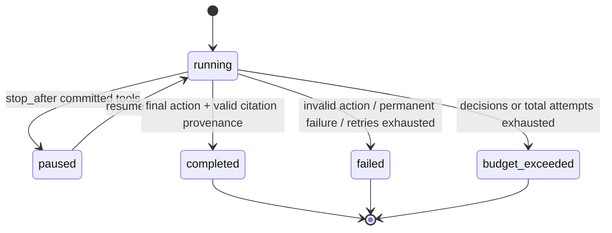

# 设计与故障语义

## 数据流

planner 只提出结构化动作，runtime 做校验与授权；工具返回的数据不能扩展 allowlist。默认策略没有大模型：它将 query 分词后检索，读取前两篇文档，按来源行的词项重合摘录。在线策略使用同一个 runtime，避免把模型 SDK 和恢复逻辑耦合。

## 状态转换

`pending` 是 running/paused 状态里的持久子状态；在工具执行前保存 `call_id`、工具参数与尝试次数。终态不能直接 resume；需要新建任务。`stop_after` 在提交一个工具结果后暂停，因此不会丢掉该工具的结果。

## SQLite 事务边界

三张表：`runs(id, revision, state)`、`events(seq, run_id, kind, time, payload)`、`results(run_id, call_id, result)`。工具结束后在同一个事务中更新 checkpoint、写入 result ledger 和追加 `tool_result` 事件。SQL 全部使用绑定参数。`revision` 乐观锁拒绝陈旧状态提交，失败时整个事务回滚。

| 崩溃位置 | 数据库状态 | 恢复动作 |
|---|---|---|
| pending 保存前 | 没有已确认动作 | 重新向 planner 请求 |
| pending 已保存、执行前 | 动作和尝试数可恢复 | 执行该动作 |
| 工具返回、结果事务提交前 | pending 仍在，结果未知 | 可能再次执行相同动作 |
| 结果事务提交后 | history、ledger、journal 一致 | 进入下一次决策 |
| final 提交后 | completed | 再次调用 run 直接返回 |

**边界语义是 at-least-once 的工具执行 + 已提交结果的本地去重**。内置工具全部只读，所以未提交的动作重做不会触发业务写入。若以后加入扣款、邮件或部署操作，需要下游服务接收同一个幂等键，并持久保存操作结果；仅靠 SQLite 无法跨系统原子提交。

此实现以**同一个 run 仅一个 worker 执行**为前提。乐观锁防止陈旧状态覆盖，但不能阻止两个进程在提交前同时执行工具。没有分布式租约、队列或多主调度。工作目录受信任且静态：路径解析能阻挡普通穿越和符号链接逃逸，但不是操作系统级隔离，也不能消除恶意进程同时修改文件导致的 TOCTOU 竞态。

## 重试与预算

- `max_steps` 包含每一次成功得到且验证通过的动作，final 也占一次。
- `max_attempts` 约束整个 run 的工具执行次数；失败调用也计数。
- `max_retries` 是每个 pending 工具以及每次 planner 决策的额外重试次数，默认 2。
- 仅 `TransientToolError` 与 `TransientProviderError` 能重试；HTTP 408/429/500/502/503/504 属于 transient。工具类型、权限、文档编码错误和非 transient HTTP 状态直接终止。
- 退避为 50 ms、100 ms；演示中没有长等待。服务端 `Retry-After`、抖动、熔断与共享限流尚未实现。
- chat 请求超时 30 秒、请求体 64000 字节上限、响应体 1000000 字节上限。没有 token、美元或整个任务墙钟预算。

重启不重置已持久化的尝试数，所以不能通过反复 resume 规避次数限制。进程在工具真正执行前崩溃也可能消耗一次预留尝试，这是保守的预算取舍。

## 权限与证据

`search/read/calculator` 是唯一内置工具。read 只允许根目录下相对 Markdown 路径，解析 symlink 后再次检查边界。calculator 只接受有限 AST 算术节点，限制表达式长度、节点数、指数和值域。没有 shell、环境变量读取或网络工具。

最终 citation guard 仅验证 `[path:Lnumber]` 是否曾由 read 返回。它无法判断引用行是否蕴含答案，也无法阻止没有引用的模型产生错误主张。真实模型的提示注入鲁棒性需要单独攻击集和语义评分；离线模拟器不会把文档内容当作执行计划，但这不构成模型安全保证。

SQLite 内部存储绝对知识库路径便于本机恢复，导出的 trace 会将根路径替换为 `<knowledge-root>`。trace 仍包括任务和实际读取的文本，因此使用自己的资料时需自行选择哪些报告公开；仓库只提交原创演示材料。

## 工程评测与后续工作

11 个端到端工程断言和更细粒度 pytest 测试覆盖正常路径、重试、预算、来源、原子提交和崩溃窗口。mock provider 测试覆盖 API 请求结构与响应结构验证，不替代真实服务集成测试。

可继续实现：租约 + 外部幂等键；冻结知识库版本与内容 hash；token/cost 预算；检索与 answer faithfulness 独立评测；真实模型在保留集上的任务成功率。先解决需求，再决定引入 LangGraph 等框架，而不是用依赖数量衡量项目复杂度。

## API 依据

- [Python sqlite3 官方文档](https://docs.python.org/3/library/sqlite3.html)：事务与 Connection 上下文管理。
- [OpenAI function calling 官方文档](https://developers.openai.com/api/docs/guides/function-calling)：工具定义、工具结果回传、串行工具调用配置。实现使用兼容 Chat Completions 路径；兼容服务行为需独立验证。
- [Python ast 官方文档](https://docs.python.org/3/library/ast.html)：解析语法树并自行解释白名单节点。

